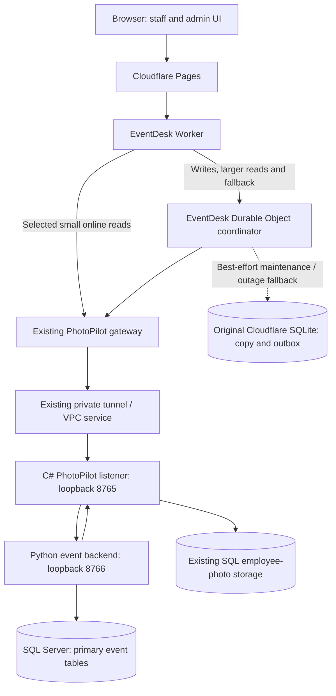
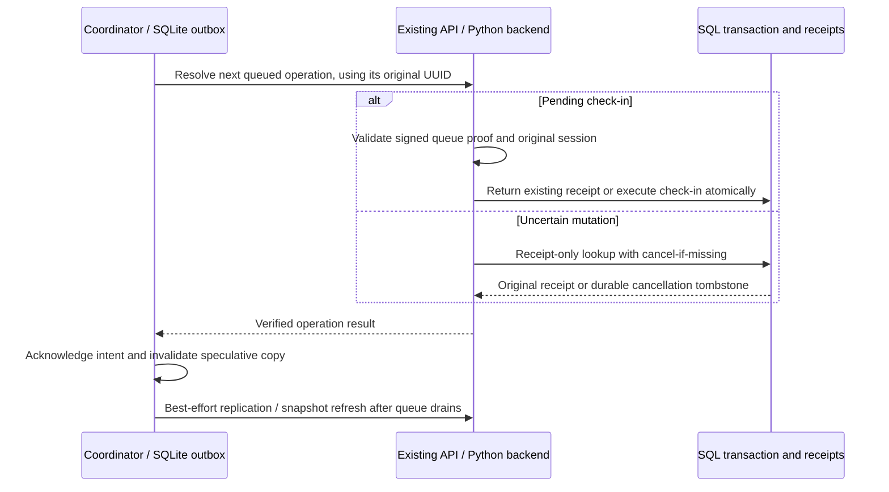

# SQL primary storage and SQLite outage recovery

Last updated: 2026-11-18.

This guide describes the implemented hosted storage path. SQL Server is the
primary database. The original Cloudflare SQLite database remains a best-effort
outage copy and durable recovery queue. SQL requests can continue when that
database reaches its quota. Other Cloudflare limits still apply. The local
standalone Python app continues to support SQLite independently.

The quota-tolerant runtime was deployed and live-tested on 2026-11-17.
Cloudflare reported an exhausted storage write quota while SQL sign-in,
check-in, exact UUID retry, a fresh duplicate scan, lookup, and logout succeeded.
The synthetic employee was removed and original SQL counts were restored.
The offline backup remains unavailable until its quota recovers; current
outage/replay behavior has local regression coverage. Earlier live outage
checks below describe their dated releases.

Examples use placeholders. Keep deployment addresses, connection settings,
employee records, exported databases, and access tokens outside source control.

## Architecture



The same gateway, listener, and tunnel carry photos and event requests. SQL
Server is not exposed directly to the browser. The Python backend has no public
listener. C# proxies only the fixed event routes to port 8766.

The browser uses the existing `/api/*` interface. Internal replication fields
and SQL connection settings are not returned to the browser.

### Reducing usage while retaining the Pages address

The Pages address remains the public entry point. Selected small, online GET
requests can use the same private SQL API directly from the outer Worker,
without invoking the Durable Object. SQL still checks the current account,
session and role. This is a server-side route; browsers never receive API bearer
tokens or SQL credentials. Larger responses and every POST retain the existing
coordinator path, including lookup, sign-in, check-in and draws.

Under traffic, the outer Worker periodically sends a read through the coordinator
to maintain the saved copy and recover queued work. Its gate is per isolate;
the coordinator's own maintenance throttle still controls backup writes.
Transport unavailability can use the original coordinator fallback. Invalid
protocol replies or rejected service credentials cannot bypass checks through
SQLite. Online reads do not resolve uncertain mutations or prove an empty queue.

This reduces Durable Object requests and avoids repeated backup access. It does
not remove the Workers daily request limit: the Pages API still needs a Worker.
There is no guarantee that all features remain available after every Cloudflare
free-tier limit is exhausted. SQL remains primary, and the original Cloudflare
SQLite copy and outbox remain available subject to their own quotas.

## Source map

| File | Responsibility |
| --- | --- |
| [worker.py](worker.py) | Hosted routing, maintenance gate, and atomic SQLite fallback dispatch |
| [read_proxy.py](read_proxy.py) | Small SQL reads without Durable Object invocations, conservative status, and per-isolate coordinator probes |
| [event_runtime.py](event_runtime.py) | Fixed service transport, request envelopes, response validation, and SQLite transaction boundary |
| [sql_online.py](sql_online.py) | Active `SQLOnlinePrimary`: SQL requests independent of backup availability, throttled maintenance, and recovery |
| [event_primary.py](event_primary.py) | Retained `SQLPrimary` implementation and shared protocol/recovery helpers |
| [replica.py](replica.py) | Revision validation, mirror updates, snapshots, and durable outbox |
| [event_policy.py](event_policy.py) | Signed-claim, CSRF, origin, and role preflight before reading large mutation bodies |
| [event_backend.py](../photo_api/event_backend.py) | Private HTTP backend, original application handlers, and replay authorization |
| [event_store.py](../photo_api/event_store.py) | SQL transactions, operation receipts, revisions, and change journal |
| [event_protocol.py](../photo_api/event_protocol.py) | Closed request schema, path/header allowlists, and bounded encoding |
| [eventdesk_storage](../eventdesk_storage) | Native SQL schema, parameterized provider, and SQLite-query compatibility |
| [EventApiProxy.cs](../photo_api/EventApiProxy.cs) | Authenticated C# event proxy with bounded I/O |
| [EventBackendService.cs](../photo_api/EventBackendService.cs) | Protected configuration and supervised Python Windows service |
| [storage-status.js](../static/storage-status.js) | Browser operation UUIDs, pending state, and uncertain-operation tracking |

## Healthy request flow

1. Before a mutation, the browser prepares a UUID v4 in
   `X-EventDesk-Operation-Id`. Retries reuse that identity instead of creating
   another action. Browser persistence limits are described below.
2. The Worker checks the request envelope and signed mutation claims. The SQL
   backend still performs authoritative application authorization.
3. The active coordinator sends ordinary SQL requests with
   `include_replica: false`. It does not require a SQLite intent or mirror write
   before sending a mutation. If a known queue is accessible, it reconciles that
   work before a conflicting write.
4. The request travels through the existing gateway and C# listener to Python.
   The backend executes the original [app.py](../app.py) rules in a serializable
   SQL transaction protected by an application lock.
5. Business changes, the operation receipt, and revisioned replication changes
   commit together. A repeated operation returns its recorded response. Reusing
   an identity with different request content returns a conflict.
6. The coordinator validates the SQL result and returns the application response
   with independent SQL, backup, and queue status. Best-effort maintenance
   requests replication separately only when the SQL revision proves the saved
   copy is behind, normally at most once per 60 seconds under traffic. SQLite
   access failures start a 300-second retry cooldown.

A validated SQL result remains authoritative even if a subsequent mirror
refresh fails. The app does not turn a known successful draw into an unknown
outcome simply because its backup could not refresh.

Backup updates are request-driven and can lag roughly 60 seconds under normal
traffic, or longer during quota exhaustion or API trouble. A ready last-good
copy can still serve an outage, but may lack new employees, recent attendance,
or the latest settings. There is no guarantee of an immediately current backup.

### Unchanged data and idle pages

After initial metadata discovery, repeated SQL requests with an unchanged
revision do not read or write SQLite and do not send a maintenance request.
Changed revisions trigger the existing throttled sync. Initial seeding,
failed-backup retries, and queued-check-in recovery remain necessary exceptions;
there is no independent timer or scheduled backup job. SQL session activity can
also change a revision, so stopping idle requests avoids those updates too.

Both staff and projector pages stop automatic polling and close their event
connections when hidden, unfocused, or inactive for two minutes. Key presses,
barcode input, taps, or returning focus resume updates with one immediate
refresh. Submitted mutations and their results are not cancelled. Automatic
projector prize-image refreshes pause as well.

The browser uses polling rather than combining finite SSE reconnections with
polling. Projector state keeps a short refresh interval during active use;
home, administration, attendance, draw summaries and eligible-ID lists refresh
less often. Scan pages have no periodic background requests. User actions still
refresh their results immediately. Stable prize cards and image elements are
reused instead of rebuilding the board on every unchanged state response.

Within each validated backup batch, repeated staff-session updates keep only
the final state for that session. This avoids writing every intermediate
activity heartbeat to SQLite. Session creation, logout/revocation and final
deletion remain represented; all original changes and revision continuity are
validated before writing. Employee, attendance, prize and audit changes retain
their original revision order.

The projector Draw button uses the same persisted operation-identity helper as
the main application. Lost replies retain the original UUID and show **Retry
draw**. Switching prizes cannot replace an unresolved operation. A successful
state refresh can confirm connectivity, but cannot resolve an uncertain draw;
that requires the original operation's result or matching server receipt.

An unattended visible projector also pauses after two minutes and keeps its
last display. It shows **Paused · Tap to reconnect**; interact with it before
expecting later draw changes to appear.

## What works when the API is unavailable

Fallback requires a previously seeded, ready copy and accessible Cloudflare
storage. Normal authentication and role checks still apply to every route.

| Operation | Behavior during a transport outage |
| --- | --- |
| Employee lookup, saved records, statistics, and permitted GET reports | Read the saved SQLite copy; recent SQL changes not yet mirrored cannot be shown |
| Employee check-in | Save the local attendance change and its replay intent in one SQLite transaction; return `202` with `pending_sync: true` |
| Login and automatic staff-session creation | Use the existing SQLite authentication path and saved configuration; SQL-side account changes may not yet be available |
| Employee photos | Return unavailable; the portrait UI uses its placeholder |
| Draws, rerolls, verification changes, wristband changes, resets, imports, settings, user changes, and logout | Pause; these POST operations are not replayed as offline business changes |
| Check-in when the mirror is unready, storage is exhausted, or the queue cannot be committed | Reject the operation rather than report it saved |

The check-in UI shows **Saved offline**, not a confirmed SQL success animation.
Other devices can see committed changes in the shared Cloudflare copy. The
pending check-in still needs SQL acceptance during recovery.
It is not eligible for SQL prize draws until replayed into SQL.

This fallback is hosted in Cloudflare, not stored in browser local storage.
The device must still reach Cloudflare. It does not support an entirely offline
phone, a Cloudflare outage, or operation beyond available Cloudflare quotas.
Employee-photo binaries remain in the existing SQL photo service and are not
copied into the employee-data fallback.

If Cloudflare SQLite quota exhaustion coincides with an API outage, no new
offline check-in can be saved. The response reports failure; it must not show
**Saved offline** without the atomic attendance-and-queue commit.

## Outage versus rejection

Network failures, timeouts, and upstream server failures are treated as
`PrimaryUnavailable` and can use fallback. A timeout does not prove that SQL
rolled back: the original transaction may have committed before its response
was lost.

Invalid service credentials, rejected envelopes, redirects, malformed JSON,
unexpected media/encoding, or invalid replication data are protocol failures.
They fail closed instead of bypassing the rejection through SQLite. An
application-level error returned inside a valid envelope remains that
application error.

The ordinary coordinator protocol-error response includes a generic message
and an opaque `X-EventDesk-Error-Code`. Photo and outer configuration failures
can return generic errors without that code. Logs contain the category code, not the
request, bearer token, connection string, or raw upstream exception.

## Recovery and duplicate protection



Requests drive queue discovery and backup maintenance; there is no independent
background synchronization daemon. Accessible, known queued work is resolved
before conflicting writes. The default coordinator processes up to 20 queued
entries per recovery pass, in insertion order. If SQLite cannot be inspected,
the queue is reported as `unknown` and ordinary SQL operations can continue.
That status does not prove an empty queue. Offline attendance is absent from
SQL and cannot enter SQL prize draws until replay succeeds.

For a queued check-in, the backend checks its receipt first. If it already
committed, the original result is returned. Otherwise the backend can replay
the check-in using the recorded time. Repeated scanning and lost responses do
not create another attendance row.

SQLite and SQL can allocate different internal row IDs for that check-in.
Acknowledging a queued check-in also marks the saved copy as needing a refresh.
After the queue is empty, a validated SQL snapshot replaces the speculative
SQLite rows in one transaction. Recovery does not overlay SQL attendance IDs
onto those local rows. If snapshot delivery fails, SQL remains available and
later application requests retry the refresh; offline changes require a ready
saved copy.

Snapshot pages request up to 1,000 rows to reduce API calls on Workers Free.
The existing response-byte limits, total-snapshot limit, revision checks, and
transactional activation still apply.

The fallback response, SQLite attendance, and SQL replay all use the UTC time
captured when the original check-in request arrived. Waiting for an unavailable
API does not change that time. The fallback temporarily binds this clock only
while dispatching that check-in, then restores the normal clock even on errors.

An uncertain draw or administrative mutation is never blindly replayed. The
coordinator requests its receipt only. If no receipt exists, SQL records a
cancellation tombstone under the same transaction lock. A late original
delivery then returns that cancellation instead of executing a second action.
A deliberate retry of the same pending operation can retain its original UUID;
do not generate a new draw identity to guess whether it already succeeded.

The coordinator does not apply SQL changes over remaining unsynchronized
local check-ins. After resolving an accessible queue, best-effort maintenance
advances the copy through validated revisions, or obtains a consistent snapshot
if required. Backup failure does not reverse a confirmed SQL operation.

### Replay authorization and conflicts

The queued check-in proof is HMAC-SHA256 over its operation identity, method,
path, encoded body, original cookie, and recorded UTC time. Browser-supplied
replay flags do not authorize this path.

Replay accepts a recorded time at most seven days old and at most five minutes
in the future. The original signed session must have been valid at that time.
This permits recovery after the browser session has subsequently expired.
Named accounts are checked again in SQL for active status and a permitted
check-in role. A known revoked session is rejected. A session created in the
fallback is not rejected merely because its session row does not yet exist in
SQL, provided the proof and required claims are valid.

An application-level check-in rejection marks its outbox entry `conflict`.
An accessible conflict pauses further business mutations for staff review.
Authorization or protocol rejection also blocks automatic recovery; it must not
be cleared by silently deleting the queued operation.

## Replication state

The catalog contains 26 event/image tables. They cover employees and QR
identities, attendance, wristbands, participants, prizes, winners, settings,
sessions, histories, audit records, and application images. Existing employee
photo storage remains separate within the same SQL-backed service.

| Store | Internal state |
| --- | --- |
| SQL Server | `EventRevision`, `EventOperationReceipt`, `EventChangeJournal`, and `EventMigrationReceipt` |
| Cloudflare SQLite | `_eventdesk_replica_meta`, `_eventdesk_outbox`, and `_eventdesk_outbox_payloads` |

Mirror metadata records `revision`, `seeded`, `ready`, and `last_sync`.
`seeded` means a complete initial copy has been installed. `ready` requires a
complete, validated revision sequence; a partial response cannot activate it.
Rows and primary keys must match the fixed catalog. Changes respect table
dependencies and deferred foreign-key checks inside the caller's transaction.

Snapshot discovery and every page use the same SQL revision. The coordinator
validates all tables and row counts before replacing the mirror atomically.
A changed revision rejects the current attempt; a later recovery attempt
restarts discovery. An empty employee snapshot cannot erase
an existing employee list. Pending operations must be reconciled before a
snapshot replacement. Recovery never uploads a stale SQLite database over SQL.

The outbox retains request identity, content hash, original envelope, saved
response, kind, and state. Large payloads use operation-owned 512 KiB chunks
with length, part-count, and SHA256 verification. Acknowledgment removes the
entry and its chunks together.

## API contract and limits

Only authenticated POSTs to `/v1/event/request` and `/v1/event/snapshot` are
proxied by the C# listener. The request route carries an allowlisted application
method/path, selected headers, base64 body, validated client IP, operation UUID,
and the copy's `after_revision`. The optional `include_replica` field accepts
only a JSON boolean and defaults to `true` for existing callers. The hosted
runtime sends `false` for ordinary SQL requests, avoiding change-journal
serialization in their responses while retaining atomic SQL receipts and
revision journaling. Maintenance requests use `true`. Snapshot discovery lists
catalog tables; pages allow up to 1,000 rows and use a fixed revision.

Replies carry application status, selected headers, base64 body, current SQL
revision, committed change batches, and completion/snapshot indicators. The
outer service envelope does not grant application permissions.

| Boundary | Current default |
| --- | --- |
| Application request body | 8 MiB |
| Private request envelope | 12 MiB |
| Private response envelope | 24 MiB |
| Coordinator snapshot assembly | 16 MiB |
| Check-in body accepted for offline routing | 16 KiB |
| Outbox capacity | 10,000 intents |
| Recovery pass | Up to 20 entries |
| Gateway/C# event deadline | 30 seconds |
| Coordinator transport deadline | 32 seconds |

Request and response sizes are checked at multiple boundaries. Deadlines cancel
network reads; they do not remove the need to reconcile a possibly committed
operation. Python Workers transport unwraps `FetchResponse.js_response` and
normalizes JavaScript-null optional headers before validation.

Browser-visible headers include:

- `X-EventDesk-Storage: sql` or `sqlite`.
- `X-EventDesk-Sync: synced` or `pending`.
- `X-EventDesk-Backup: current`, `stale`, or `unavailable`.
- `X-EventDesk-Queue: clear`, `pending`, or `unknown`.

SQL/`synced` means the current SQL operation was confirmed; it does not certify
the backup or prove the recovery queue is empty. `current` means the saved
revision matches the SQL revision known to this coordinator. `stale` means the
copy is behind or not ready; `unavailable` means local access failed. A healthy
SQL request can succeed with an unavailable backup and an unknown queue.

An ordinary healthy read, unrelated action, or late photo must not clear an
uncertain mutation. The browser resolves only the exact operation identity;
there is no global `X-EventDesk-Uncertain: clear` shortcut. It blocks other
unsafe actions while a mutation is uncertain and permits retrying that action
with its original UUID.

Before sending a mutation, the browser saves a SHA256 request-identity key, UUID,
and creation time in `localStorage`. It does not persist raw employee data,
request bodies, cookies, or CSRF values there. Supported browser storage keeps
retry identities across reloads. If storage or digest support is unavailable,
identity tracking is memory-only and does not survive a reload. Staff must
resolve an unknown outcome before starting a replacement action.

## Configuration and service operations

| Binding | Meaning |
| --- | --- |
| `EVENT_STORAGE=sql` | Default hosted coordinator path |
| `EVENT_STORAGE=sqlite` | Explicit original path for a controlled rollback |
| `EVENT_MAINTENANCE=1` | Reject hosted `/api` traffic before database work |
| `PHOTO_PILOT` | Existing private gateway service binding |
| `PHOTO_PILOT_ACCESS_TOKEN` | Secret used to authenticate that service request |
| `APP_CONFIG` | Protected signing configuration and password hashes |

Do not toggle to explicit SQLite as an ad hoc repair for an uncertain draw.
Reconcile the queue and establish the authoritative state first. A flag change
does not copy a standalone local SQLite database into the hosted mirror.

On the approved API host, these commands inspect or start the existing services:

```powershell
Get-Service EventDeskPhotoApi, EventDeskEventBackend
Start-Service EventDeskPhotoApi
Start-Service EventDeskEventBackend
```

The private Python health endpoint is `http://127.0.0.1:8766/healthz` and requires
its bearer. Use an approved local diagnostic client that reads protected
settings; do not paste tokens into terminal history. An unauthenticated `401`
is not an authenticated health check. Inspect the public application's response
headers at the actual configured origin to verify its end-to-end storage path.

The supervisor reuses the photo service's protected SQL settings, passes startup
configuration through private stdin, and restricts the runtime to SYSTEM and
Administrators. It supervises Python in a Windows Job Object. Service stop sends
an authenticated, empty local shutdown POST, drains requests for up to 35
seconds, and terminates the contained process if necessary.

### Incident checklist

1. Confirm the browser can still reach Cloudflare and inspect storage/sync
   headers. Distinguish transport unavailability from a protocol support code.
2. Check the API host, tunnel, both services, SQL connectivity, and protected
   configuration without publishing their values.
3. Restore service and allow ordinary application requests to drive recovery.
   Expect several passes for a large queue.
4. Check SQL/`synced`, backup status, and queue status separately. For full
   recovery, confirm the queue is empty and the saved copy is ready with matching
   revisions. `unknown` queue status cannot certify recovered offline attendance.
5. If an entry conflicts or authorization was revoked, preserve its identity and
   receipt evidence for review. Do not delete it or overwrite SQL from a backup.

## Native SQL compatibility and migration

The provider targets SQL Server 2014 or newer, with compatibility level 120 or
newer. It uses parameterized application queries and an explicit SQL AST
compatibility layer; it is not an arbitrary-SQL HTTP endpoint.

Large `IN` lists use bound XML instead of newer `OPENJSON` functions. The
compiler lowers SQLite boolean/CASE expressions while preserving NULL behavior.
For DISTINCT text followed by case-insensitive ordering, it uses a binary key
and byte-length companion, then restores Unicode text in the outer projection.
This preserves case, trailing spaces, trailing NULs, and Unicode values while
avoiding SQL Server 2014's repeated-COLLATE restriction.

Migration preserves identities, relationships, and image bytes, verifies table
counts and hashes, and commits an import receipt. Identity seeds are checked
with parameterized `IDENT_CURRENT` after `IDENTITY_INSERT`; a broad database
owner role or `DBCC CHECKIDENT` is not required. Follow the detailed
[deployment runbook](../DEPLOYMENT.md#sql-primary-cutover-and-recovery) for schema
permissions, maintenance, protected packages, and the frozen source export.

## Verification

A controlled live test of the earlier runtime on 2026-11-17 used a uniquely
tagged synthetic employee
excluded from prize draws. With the event backend stopped, the check-in returned
`202`/SQLite/pending, one attendance row and one intent were saved in SQLite,
and SQL still had no attendance for that employee. After restoring the backend,
ordinary requests recovered one SQL attendance row and its operation receipt.
Both a repeated operation UUID and a new scan kept the count at one. The original
UTC timestamp was unchanged. The refreshed mirror was ready with an empty queue;
all synthetic employees were removed and the original attendance count remained
unchanged. Regression tests also cover mismatched SQL/SQLite identities and
snapshot-refresh failure followed by retry.

Local quota and lifecycle regression checks cover the new runtime; its live
deployment has not yet been verified. The implemented checks also cover native
SQL import integrity, concurrent business rules, replay, lost commit
acknowledgments, cancellation fencing, mirror
validation, authorization boundaries, and large payload handling. Key suites:

- [test_sql_migration_rehearsal.py](../tests/test_sql_migration_rehearsal.py):
  isolated full-data import, pending replay, lost receipts, late draw delivery,
  and real application read routes.
- [test_sql_online.py](../tests/test_sql_online.py) and
  [test_sql_online_runtime.py](../tests/test_sql_online_runtime.py):
  quota-tolerant routing, backup maintenance, and runtime lifecycle.
- [test_event_primary.py](../tests/test_event_primary.py) and
  [test_event_replica.py](../tests/test_event_replica.py): coordinator and mirror.
- [test_sql_worker_integration.py](../tests/test_sql_worker_integration.py) and
  [test_sql_worker_transactions.py](../tests/test_sql_worker_transactions.py):
  hosted boundaries, JavaScript-null headers, and attendance/outbox atomicity.
- [test_event_backend.py](../tests/test_event_backend.py),
  [test_event_protocol.py](../tests/test_event_protocol.py), and
  [test_sqlserver_native.py](../tests/test_sqlserver_native.py): backend protocol,
  native SQL behavior, and access checks.
- [test_storage_status.js](../tests/test_storage_status.js): browser pending and
  uncertain states. C# proxy/service and PowerShell installer/migration suites
  live under [photo_api/tests](../photo_api/tests).

Rehearse outages in an isolated database with synthetic employees. For a live
read-only outage check, retain existing attendance/winner counts, stop only the
event backend briefly, verify a saved read uses SQLite, restore the backend, and
verify SQL/synced recovery. Do not create a real check-in or draw to test failure.
Preserve the configured 10% Observability sampling. Free-plan quotas still apply
to the mirror and queue; moving primary queries to SQL does not make Cloudflare
storage unlimited.
